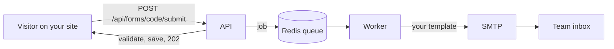

<h1 align="center">➤ Form Sender</h1>

<p align="center">
  <b>The email API for your website forms.</b><br>
  Send email from any website form without writing a back end. Self-hosted, open source and up in one command. Point a form at a URL and every message lands in your team's inbox, in a template you design.
</p>

<p align="center">
  <a href="https://github.com/gustavocoimbradev/form-sender/actions/workflows/ci.yml"></a>
  
  
  
  
  <a href="LICENSE"></a>
</p>

<p align="center"></p>

## What it is

An email-sending API for forms. Your website sends a `POST`, Form Sender validates it, stores it, answers `202` right away and delivers the email in the background.

```bash
curl -X POST http://localhost:8000/api/forms/YOUR_FORM_CODE/submit \
  -H 'Origin: https://your-site.com' \
  -H 'Content-Type: application/json' \
  -d '{"name": "Maria", "email": "maria@company.com", "message": "Hello!"}'
# 202 Accepted. The email is already on its way.
```

You should not have to write, secure and maintain email sending for every contact page, landing page or signup sheet. Run Form Sender once and every site you own can use it.

1. **Create a form** in the dashboard: its fields, who receives the messages, which sites may send it.
2. **Add it to your site** with one `<script>` line (or an iframe), or just share the form's public page.
3. **Done.** Each submission is validated, saved, and emailed to your team.

## What you can use it for

Anything that starts as a `POST` and should end as an email:

- Contact forms and quote requests
- Waitlists and newsletter signups
- Lead capture on landing pages
- Support and feedback widgets
- Notifications from your own apps (new signup, new order, an error worth a look)

## How the email API works



## Highlights

| | |
|---|---|
| **Instant and reliable** | Emails never block a request, so your page never waits for a mail server. Redis queue, retries with backoff, and a delivery status **per destination** (`pending`, `sent`, `partial`, `failed`). |
| **File attachments** | Add a **file field** to a form: the upload is stored privately and arrives as an **email attachment**. Size and type are limited (5 MB by default; documents and images only), and the generated snippets already send it as `multipart/form-data`. |
| **One line to embed, always up to date** | A `<script>` tag draws the form with the fields you configured, so editing the form changes every site that uses it. Sending never leaves the page: a small notice at the bottom confirms it (or points at what to fix). No JavaScript allowed? Use the iframe. Every form also has a **public page** of its own, fully responsive, with a clean version when it is framed. |
| **Your own look** | Each form's **Design** tab shows the form next to the CSS that draws it, already filled in with the current style so you can edit it, with a live preview (light and dark) and a **Restore default style** button. The style only ever applies to the form, never to the page around it. |
| **Your own words** | The **Strings** tab lists every text the form shows by itself (the send button, the "sent" notice, the messages about a field) so you can write them in your language, with a live preview. Texts you leave alone keep following the defaults. |
| **Reply to the visitor** | The first email a visitor types becomes the `Reply-To` of the message your team receives. |
| **An email per form** | Each form has its own email, written in the form's **Email** tab: a **code editor made for email** (autocomplete on `{{`, a linter that warns about CSS email clients ignore) and a **live preview** on desktop and phone widths, filled with the form's own fields. Until you write one, the default email (it matches the dashboard's look) is used, and **Reset to default** brings it back. |
| **Spam protection** | A built-in **honeypot** on every form: the embed script and the public page already include a hidden `_gotcha` field. Bots fill it, the API still answers `202` as if nothing happened, and the message is kept under Messages as **Spam**, never emailed. |
| **No secrets in the browser** | No token to leak. A form is reached by a random public `code`; sending is controlled by its **allowed sites** (`Origin`/`Referer`, `*.company.com` wildcards, per-form CORS) and rate limiting. Numeric ids are never exposed. |
| **Audit trail and retention** | Every message is stored with a snapshot of the form, and it stays even if the form is deleted. Nothing is ever deleted by default. Set `SUBMISSION_RETENTION_DAYS` and a daily cleanup removes messages (and their files) older than that. |
| **Retry and alerts** | A message that failed can be retried from the dashboard (destinations that already got it are skipped). When a delivery fails for good, every admin gets an email. |
| **Teams and roles** | `admin` and `user`. Users manage forms; admins also manage people and SMTP. Only the *owner* (first admin) can touch other admins. |
| **SMTP at runtime** | Configured in the panel, stored encrypted, never in `.env`. Locally it points at Mailpit. |
| **Self-documenting API** | OpenAPI docs generated from the code, written in plain language, and **enforced by tests**: an undocumented endpoint fails the build. |

## Screens

<table>
  <tr>
    <td width="50%"></td>
    <td width="50%"></td>
  </tr>
  <tr>
    <td align="center"><sub>One line to paste, or an iframe</sub></td>
    <td align="center"><sub>Every message, with its delivery status</sub></td>
  </tr>
</table>

## What is Mailpit?

[Mailpit](https://mailpit.axllent.org) is a **fake SMTP server with a web inbox**. In development, Form Sender sends every email to it instead of to real people: nothing leaves your machine, and you can open the inbox and see exactly what your template produces. It comes with the Docker setup, is wired up automatically, and has a shortcut in the panel's user menu (admins only).

## Run it in one command

Requires Docker.

```bash
make up
```

It checks Docker, picks **free ports on its own** (so it never collides with anything you already run), starts everything, seeds the database and prints:

```
✔ Form Sender is up!

  Dashboard  http://localhost:3000
  API        http://localhost:8000
  Mailpit    http://localhost:8025
```

Open the **Dashboard**, create the first admin (a two-step setup: administrator, then SMTP, already filled with Mailpit), and try the example **Contact** form that comes ready (name and email required, message optional), or build your own. **Ctrl+C** stops everything.

| Command | |
|---|---|
| `make up logs` | Same, streaming every log |
| `make start` / `make down` | Run in the background / stop |
| `make test` | Run the whole test suite |
| `make reset` | Back to a fresh install (asks first) |
| `make urls` / `make status` | Every URL / container status |

## Under the hood

### Back-end: `/backend`

Headless **Laravel 13** on **PHP 8.4**, **PostgreSQL 16**, **Redis**, **Sanctum** for dashboard users.

- **The Laravel way, no over-engineering.** Form Requests, API Resources, Policies, route-model binding, Eloquent. Controllers stay thin; an Action class exists only when a use case earns it (multi-step, transactional, side effects). No repositories or service layers "just in case".
- **Strict and typed everywhere.** `declare(strict_types=1)` on every file, typed parameters, returns and properties.
- **CI on every push.** The Pest suite runs against **SQLite and a real PostgreSQL 16**, next to **Pint** (code style) and **Larastan** (static analysis).
- **Hardened by default.** Security headers, restricted CORS, per-route throttling, login without account enumeration, password reset by a hashed emailed code, encrypted queue payloads for secrets.
- **One renderer.** The same `EmailTemplateRenderer` produces the delivered email and the editor preview, and escapes every submitted value.

### Front-end: `/frontend`

**Next.js 14** (App Router), **TypeScript**, **Tailwind**, **CodeMirror 6**.

- **A real product UI**, not a landing page: dark, violet-to-cyan identity, glass cards, a floating bottom bar on phones, a sliding round navigation on desktop.
- **Mobile-first** and checked at 360 to 1440px: no horizontal scroll, 44px touch targets, 16px minimum text.
- **Custom controls** (searchable selects, switches, chips) instead of native ones, with CSS-only micro-animations that respect `prefers-reduced-motion`.
- **Same-origin `/api` proxy**, so the browser never deals with CORS; one typed API client; 422 errors map to the inputs and only a `401` ends a session.
- **Design tokens** for every color, radius and duration.

### Infra

Docker Compose at the root runs the API, queue worker, front-end, PostgreSQL, Redis and Mailpit. GitHub Actions runs the full suite on every push and pull request.

## API at a glance

Full, friendly docs are served at the API root (`/`).

| Area | Endpoints |
|---|---|
| Setup and auth | `POST /setup`, `POST /auth/login`, `POST /auth/logout`, `GET /auth/me`, password reset |
| Forms | CRUD on `/forms/{code}` |
| Submitting | `POST /forms/{code}/submit` and `GET /forms/{code}/public` (the fields to draw), both public: allowed sites, no token |
| Submissions | `GET /forms/{code}/submissions` (+ filter by status), `POST /forms/{code}/submissions/{id}/retry`, `GET /forms/{code}/submissions/{id}/attachments/{attachment}` |
| Email, style and texts | `GET /email/default`, `POST /email/preview`, `GET /style/default`, `GET /strings/default` |
| Users, Settings | CRUD on `/users`, `GET`/`PUT /settings` (admin) |


## License

[MIT](LICENSE): free to use, copy, modify and distribute, including commercially, as long as the copyright notice (credit to **Gustavo Coimbra**) is kept.

## Structure

```
backend/     Laravel API (Actions, Http, Jobs, Policies, Support, tests)
frontend/    Next.js dashboard
docker/      PHP image and entrypoint
scripts/     make up: free ports, URLs, reset, branding
docs/        screenshots
.github/     CI workflow
```
