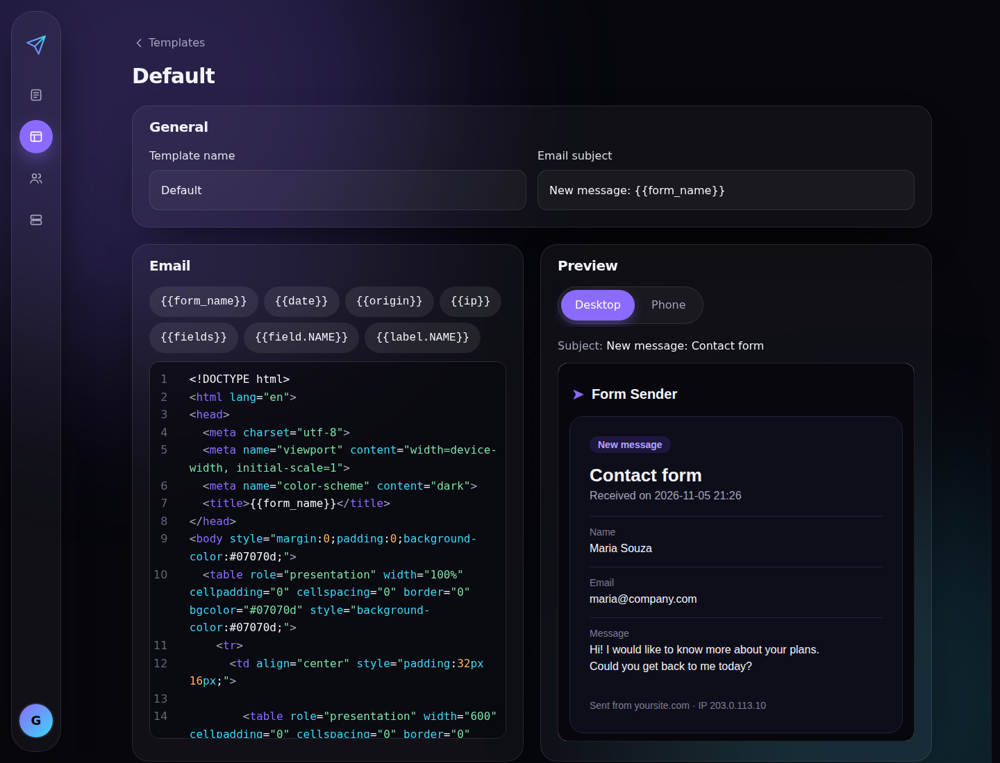
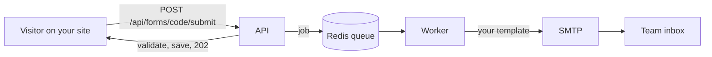
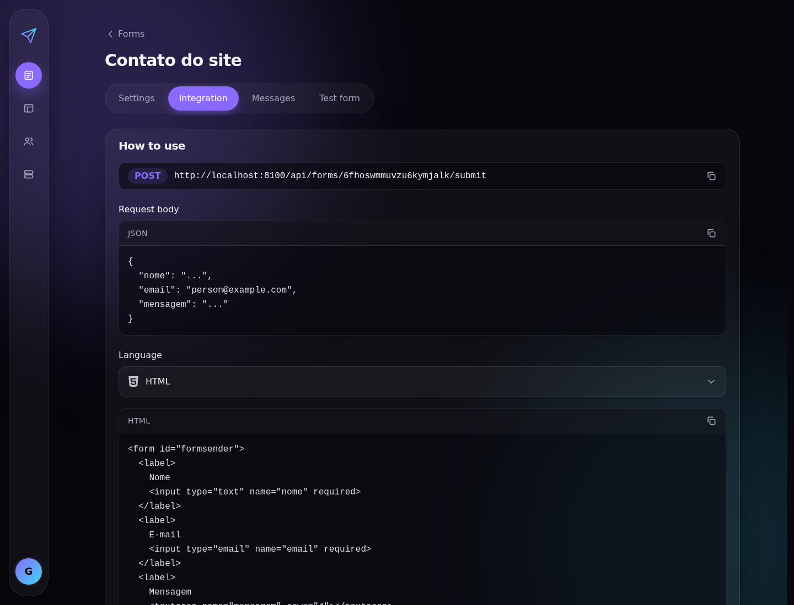
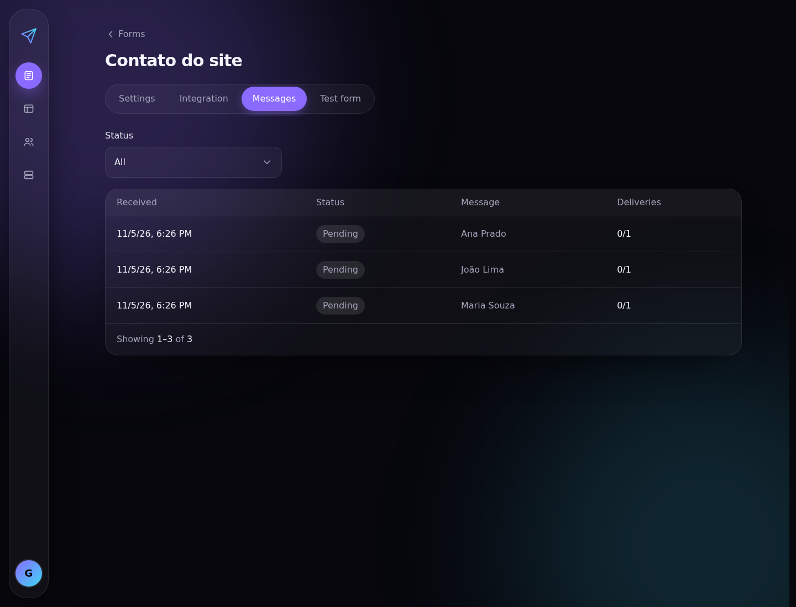

<h1 align="center">➤ Form Sender</h1>

<p align="center">
  <b>Forms without a backend.</b><br>
  Create a form, paste one snippet into any website, and every message lands in your inbox, beautifully formatted.
</p>

<p align="center">
  <a href="https://github.com/gustavocoimbradev/form-sender/actions/workflows/ci.yml"></a>
  
  
  
  
  
</p>

<p align="center"></p>

## What it does

You have a contact page, a landing page, a signup sheet. You do **not** want to build a server just to receive what people type.

1. **Create a form** in the dashboard: its fields, who receives the messages, which sites may send it.
2. **Copy the snippet** (HTML, JavaScript, React, PHP, Python... the panel generates it for your stack).
3. **Done.** Each submission is validated, saved, and emailed to your team, with the answer arriving instantly (`202`) because the email goes out in the background.



## Highlights

| | |
|---|---|
| **Instant and reliable** | Emails never block a request. Redis queue, retries with backoff, and a delivery status **per destination** (`pending`, `sent`, `partial`, `failed`). |
| **Email templates** | Each form picks its own email. Write it in a **code editor made for email** (autocomplete on `{{`, a linter that warns about CSS email clients ignore) and watch a **live preview** on desktop and phone widths. The default template already matches the dashboard's look. |
| **No secrets in the browser** | No token to leak. A form is reached by a random public `code`; sending is controlled by its **allowed sites** (`Origin`/`Referer`, `*.company.com` wildcards, per-form CORS) and rate limiting. Numeric ids are never exposed. |
| **Audit trail** | Every message is stored with a snapshot of the form, and it stays even if the form is deleted. |
| **Teams and roles** | `admin` and `user`. Users manage forms; admins also manage people and SMTP. Only the *owner* (first admin) can touch other admins. |
| **SMTP at runtime** | Configured in the panel, stored encrypted, never in `.env`. Locally it points at Mailpit. |
| **Self-documenting API** | OpenAPI docs generated from the code, written in plain language, and **enforced by tests**: an undocumented endpoint fails the build. |

## Screens

<table>
  <tr>
    <td width="50%"></td>
    <td width="50%"></td>
  </tr>
  <tr>
    <td align="center"><sub>Ready-to-paste snippets, one per stack</sub></td>
    <td align="center"><sub>Every message, with its delivery status</sub></td>
  </tr>
</table>

## What is Mailpit?

[Mailpit](https://mailpit.axllent.org) is a **fake SMTP server with a web inbox**. In development, Form Sender sends every email to it instead of to real people: nothing leaves your machine, and you can open the inbox and see exactly what your template produces. It comes with the Docker setup, is wired up automatically, and has a shortcut in the panel's user menu (admins only).

## Run it in one command

Requires Docker.

```bash
make up
```

It checks Docker, picks **free ports on its own** (so it never collides with anything you already run), starts everything, seeds the database and prints:

```
✔ Form Sender is up!

  Dashboard  http://localhost:3000
  API        http://localhost:8000
  Mailpit    http://localhost:8025
```

Open the **Dashboard**, create the first admin (a two-step setup: administrator, then SMTP, already filled with Mailpit), and build your first form. **Ctrl+C** stops everything.

| Command | |
|---|---|
| `make up logs` | Same, streaming every log |
| `make start` / `make down` | Run in the background / stop |
| `make test` | Run the whole test suite |
| `make reset` | Back to a fresh install (asks first) |
| `make urls` / `make status` | Every URL / container status |

## Under the hood

### Back-end: `/backend`

Headless **Laravel 13** on **PHP 8.4**, **PostgreSQL 16**, **Redis**, **Sanctum** for dashboard users.

- **The Laravel way, no over-engineering.** Form Requests, API Resources, Policies, route-model binding, Eloquent. Controllers stay thin; an Action class exists only when a use case earns it (multi-step, transactional, side effects). No repositories or service layers "just in case".
- **Strict and typed everywhere.** `declare(strict_types=1)` on every file, typed parameters, returns and properties.
- **Test-driven.** 311 Pest tests written before the code. CI runs them on every push against **SQLite and a real PostgreSQL 16**.
- **Hardened by default.** Security headers, restricted CORS, per-route throttling, login without account enumeration, password reset by a hashed emailed code, encrypted queue payloads for secrets.
- **One renderer.** The same `EmailTemplateRenderer` produces the delivered email and the editor preview, and escapes every submitted value.

### Front-end: `/frontend`

**Next.js 14** (App Router), **TypeScript**, **Tailwind**, **CodeMirror 6**.

- **A real product UI**, not a landing page: dark, violet-to-cyan identity, glass cards, a floating bottom bar on phones, a sliding round navigation on desktop.
- **Mobile-first** and checked at 360 to 1440px: no horizontal scroll, 44px touch targets, 16px minimum text.
- **Custom controls** (searchable selects, switches, chips) instead of native ones, with CSS-only micro-animations that respect `prefers-reduced-motion`.
- **Same-origin `/api` proxy**, so the browser never deals with CORS; one typed API client; 422 errors map to the inputs and only a `401` ends a session.
- **Design tokens** for every color, radius and duration.

### Infra

Docker Compose at the root runs the API, queue worker, front-end, PostgreSQL, Redis and Mailpit. GitHub Actions runs the full suite on every push and pull request.

## API at a glance

Full, friendly docs are served at the API root (`/`).

| Area | Endpoints |
|---|---|
| Setup and auth | `POST /setup`, `POST /auth/login`, `POST /auth/logout`, `GET /auth/me`, password reset |
| Forms | CRUD on `/forms/{code}`, `POST /forms/{code}/test` |
| Submitting | `POST /forms/{code}/submit` (public: allowed sites, no token) |
| Submissions | `GET /forms/{code}/submissions` (+ filter by status) |
| Templates | CRUD on `/templates/{code}`, `POST /templates/preview` |
| Users, Settings | CRUD on `/users`, `GET`/`PUT /settings` (admin) |

```bash
# What a website sends. No token, no backend of your own.
curl -X POST http://localhost:8000/api/forms/YOUR_FORM_CODE/submit \
  -H 'Origin: https://your-site.com' \
  -H 'Content-Type: application/json' \
  -d '{"name": "Maria", "email": "maria@company.com", "message": "Hello!"}'
```

## Structure

```
backend/     Laravel API (Actions, Http, Jobs, Policies, Support, tests)
frontend/    Next.js dashboard
docker/      PHP image and entrypoint
scripts/     make up: free ports, URLs, reset, branding
docs/        screenshots
.github/     CI workflow
```
