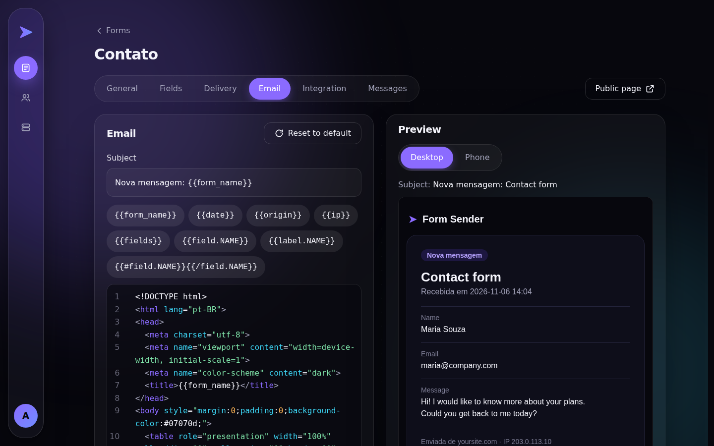

<h1 align="center">➤ Form Sender</h1>

<p align="center">
  <b>The email API for your website forms.</b><br>
  Send email from any website form without writing a back end. Self-hosted, open source and up in one command. Point a form at a URL and every message lands in your team's inbox, in a template you design.
</p>

<p align="center">
  <a href="https://github.com/gustavocoimbradev/form-sender/actions/workflows/ci.yml"></a>
  
  
  
  
  <a href="LICENSE"></a>
</p>

<p align="center"></p>

## What it does

Your site gets a form, and every message lands in your team's inbox. No back end to write: Form Sender validates it, stores it, answers right away and sends the email in the background.

1. **Create a form** in the dashboard: fields, destinations, design, texts, email.
2. **Add one line to your site:**

```html
<script src="https://YOUR-DOMAIN/embed.js" data-form="FORM_CODE" async></script>
```

3. **Done.** The form draws itself with the fields you set, and edits made in the dashboard reach every site at once. Prefer an `<iframe>`, or a link? Every form also has its own public page.

## Run it

Needs Docker.

```bash
make up:dev   # development: everything up with sample data, a fake inbox (Mailpit) and free ports picked for you
make up:prod  # production: asks for your address the first time, then builds and runs it for good
```

Keep `APP_KEY` safe: the saved SMTP password is encrypted with it. Without a keyboard, `ADDRESS=forms.mycompany.com make up:prod`. Over an IP the site is plain http, so a form on an https website needs a domain.

## What is in it

- **Three ways in:** a script, an iframe or a public page (with our credit), all drawn from the same form.
- **Your design and your words:** a CSS editor with a live preview (color swatches, snippets, formatting) and every text of the form editable, in any language.
- **An email per form:** code editor with live preview; replying goes to the visitor. File fields arrive as attachments.
- **Reliable:** emails go through a queue with retries, a status per destination, a retry button and an alert to the form's owner when one fails for good.
- **Spam stays in view:** a hidden trap field, allowed sites per form and rate limits. Caught messages are kept as Spam, never emailed.
- **Accounts:** the administrator sees every form; with "Allow new accounts" on, anyone can sign up (email confirmed by a link) and manage only their own forms, and each destination confirms by email before it receives messages. SMTP is set in the dashboard (stored encrypted), with optional retention of old messages.

<table>
  <tr>
    <td width="50%"></td>
    <td width="50%"></td>
  </tr>
</table>

## Under the hood

**Laravel 13** (PHP 8.4), **PostgreSQL 16**, **Redis**, **Next.js 14** with TypeScript and Tailwind, all in Docker Compose. The API is documented in plain language at its root in development (OpenAPI, generated from the code and checked by the tests). CI runs the Pest suite on SQLite and PostgreSQL, plus Pint and Larastan.

```
backend/     Laravel API
frontend/    Next.js dashboard
docker/      PHP image, production images and proxy
scripts/     make up:dev and make up:prod
```

## License

[MIT](LICENSE): free to use, copy, modify and distribute, including commercially, as long as the copyright notice (credit to **Gustavo Coimbra**) is kept.
